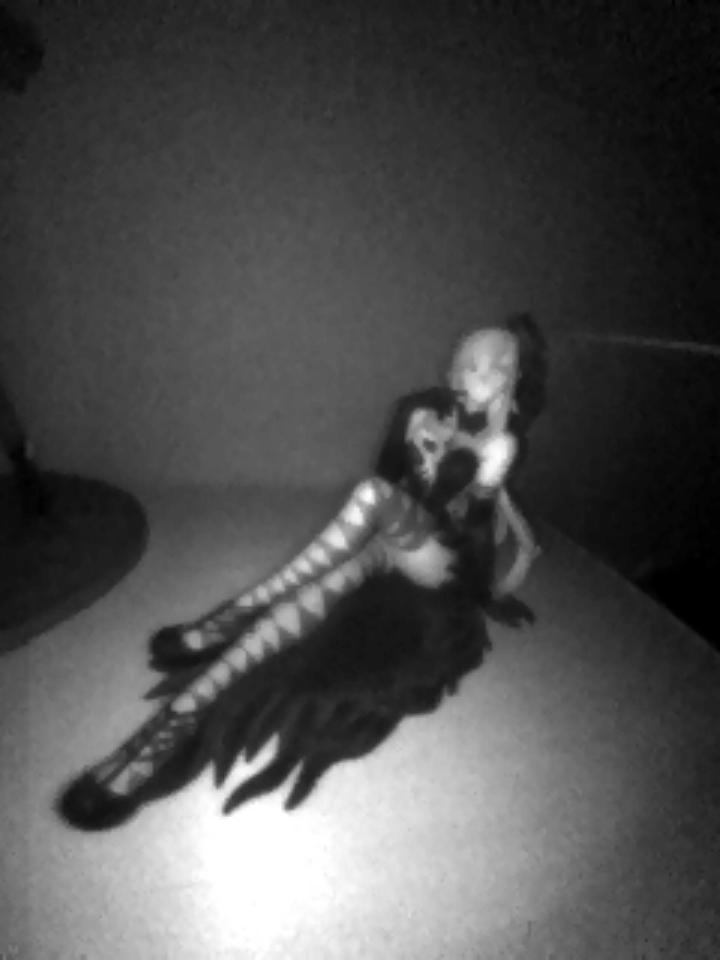
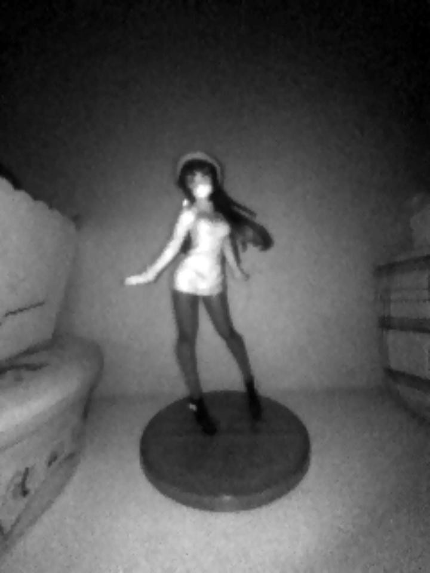

# Joy-Con IR Camera for Android

Turns the IR camera of the right Joy-Con into a working camera on a Nintendo Switch
running Android (LineageOS / Switchroot): a live viewfinder, photos, palettes, auto
exposure and Joy-Con buttons. As far as we know, it is the first app that does this on Android.

The Joy-Con's IR sensor (a 320×240 monochrome camera with IR LEDs, at the bottom end of the
right Joy-Con) talks to the console over Bluetooth through its MCU. Android has no driver
for it. This project speaks that protocol directly through `/dev/hidraw` as root.

<p align="center">
  
  
</p>

## Requirements

- Nintendo Switch with Android, tested on LineageOS 22.2 (Android 15), kernel 4.9.
  Other Android devices with Bluetooth and root should also work, but that is untested.
- **Root with a `su` binary** (tested with Magisk; KernelSU or APatch should work too). The app
  runs its helper through `su`, because the helper needs root to open `/dev/hidraw*` and to
  change Wi-Fi power save. Without root, the app cannot reach the camera.
- The **right Joy-Con detached and connected over Bluetooth**. The rail (UART) link is
  not supported.
- Joy-Con MCU firmware 5.18 or newer. A Joy-Con that was ever updated on a Switch running
  Nintendo's firmware has it; with an older one, the camera fails at step 6.

## Install

Download `IrCamera.apk` from [Releases](../../releases), install it, open **IR Camera** and
grant superuser access when your root manager (Magisk, etc.) asks. If you deny it, grant it
later in the root manager's app list.

| Joy-Con button | Action |
|---|---|
| A / ZR / SR | photo |
| X / SL | palette (Night, Thermal, B/W, Rainbow, Negative) |
| Y | mode: 80×60 video, 160×120 video, 320×240 photo, 40×30 turbo |
| R | IR light on/off |
| + | exposure (auto, 600…30 µs) |
| R stick press | auto contrast on/off |
| B | exit |

Photos are saved as PNG to `Pictures/JoyConIR`.

## How it works

- **Protocol.** The app puts the Joy-Con into MCU report mode 0x31 and switches its MCU to IR
  mode. It configures the sensor registers (resolution, exposure, gain, LEDs) and requests
  image transfer (IR mode 7). The image arrives in 300-byte fragments, and each one is
  acknowledged.
- **Speed.** The Joy-Con sends one report every ~15 ms on both Bluetooth and the rail, so
  a 320×240 frame (256 fragments) takes ~3.4 s, 160×120 ~0.8 s, 80×60 ~0.2 s and 40×30
  ~60 ms.
- **One frame = one snapshot.** The sensor captures the whole frame at once and then
  transfers it, so a frame has no rolling-shutter tearing even while the Joy-Con moves.
  The viewfinder shows whole frames, and a photo is exactly one snapshot.
- **Lost fragments.** jc_toolkit's strict order (ask for a resend and wait for it) stalls
  for seconds on a real link. Instead, the helper keeps every fragment as it arrives (`-m 1`).
  - In the viewfinder, a lost fragment is interpolated from the fresh rows around it.
  - In a photo, it is taken from the next pass if the scene did not move between the two
    snapshots, and interpolated otherwise.
- **Wi-Fi power save.** This was the main cause of losses: the Switch's BCM4356 shares one
  radio between Wi-Fi and Bluetooth. With Wi-Fi power save on, Bluetooth goes deaf for
  70–100 ms every ~640 ms and loses 5–10% of the fragments. The helper turns power save off
  while streaming and restores it on exit, which brings losses under 2%.
- **Buttons.** Android's `hid-nintendo` ignores 0x31 reports, so while streaming, the right
  Joy-Con's buttons reach the app through the helper's stream.

The root helper `ircam.c` also works on its own:

```sh
su -c './ircam -r 160 -o frame.pgm'                 # one frame as PGM
su -c './ircam -r 80 -n 0 -o - -v' >/dev/null       # stream; link statistics every 5 s
su -c './ircam -x'                                  # reset a Joy-Con left in IR mode
```

The options and the stream format are documented at the top of [ircam.c](ircam.c).

## Building

The APK is built on the device itself in [Termux](https://termux.dev), without Gradle:

```sh
pkg install clang openjdk-21 aapt2 aapt apksigner zip unzip curl
bash tools/fetch.sh     # android.jar (API 30) and r8.jar from dl.google.com
bash build.sh           # -> build/IrCamera.apk
```

`build.sh` creates a signing key `ircam.jks` on first run. Set `KEYSTORE` and `KS_PASS` to
use your own.

## Credits

- [CTCaer/jc_toolkit](https://github.com/CTCaer/jc_toolkit) (MIT): the IR camera
  initialization sequence, register values and transfer protocol.
- [dekuNukem/Nintendo_Switch_Reverse_Engineering](https://github.com/dekuNukem/Nintendo_Switch_Reverse_Engineering):
  the Joy-Con HID protocol notes.

See [NOTICE](NOTICE).

## License

[MIT](LICENSE).

Not affiliated with or endorsed by Nintendo. "Nintendo Switch" and "Joy-Con" are
trademarks of Nintendo.
